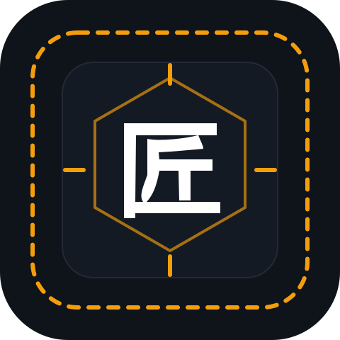
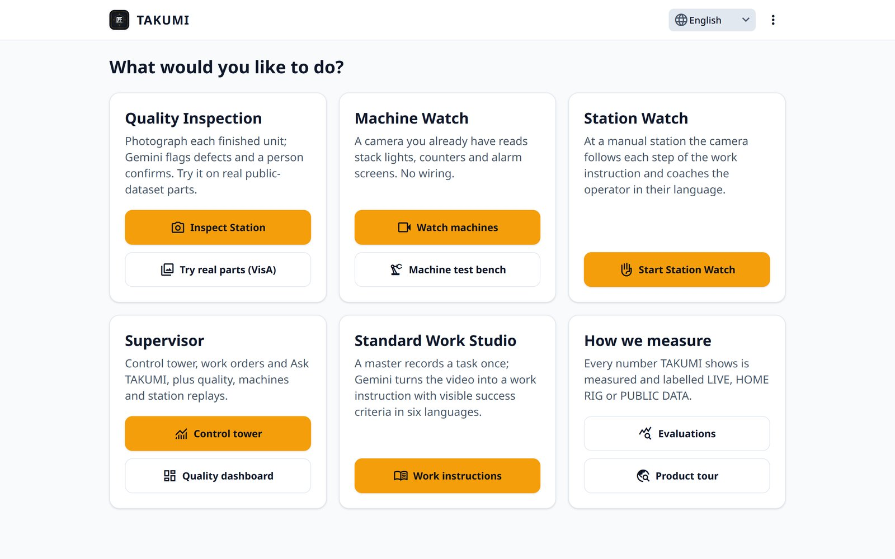
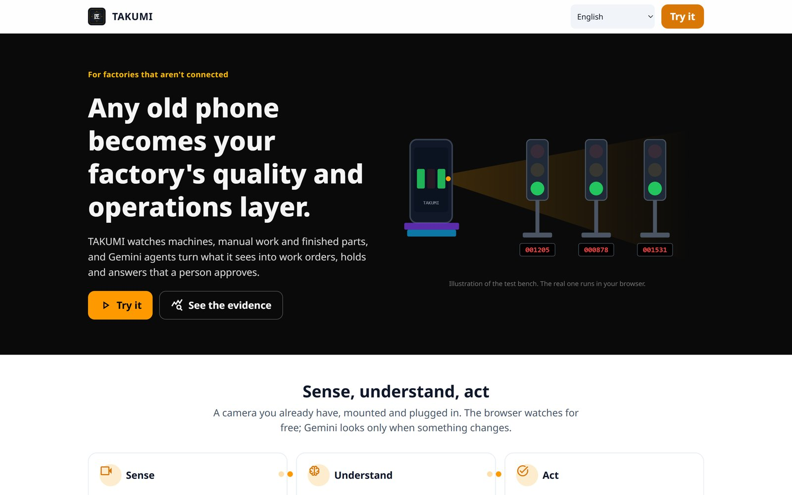
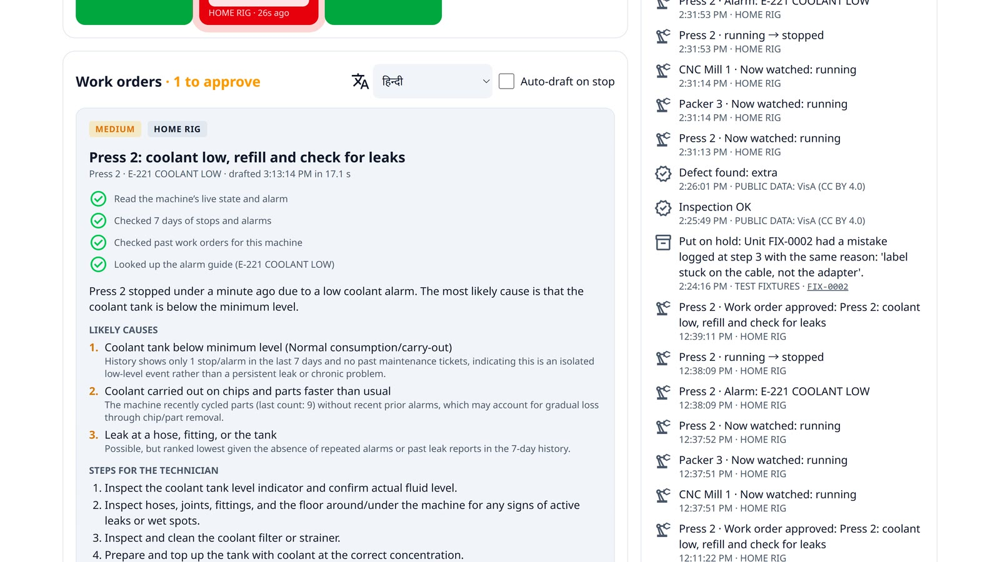
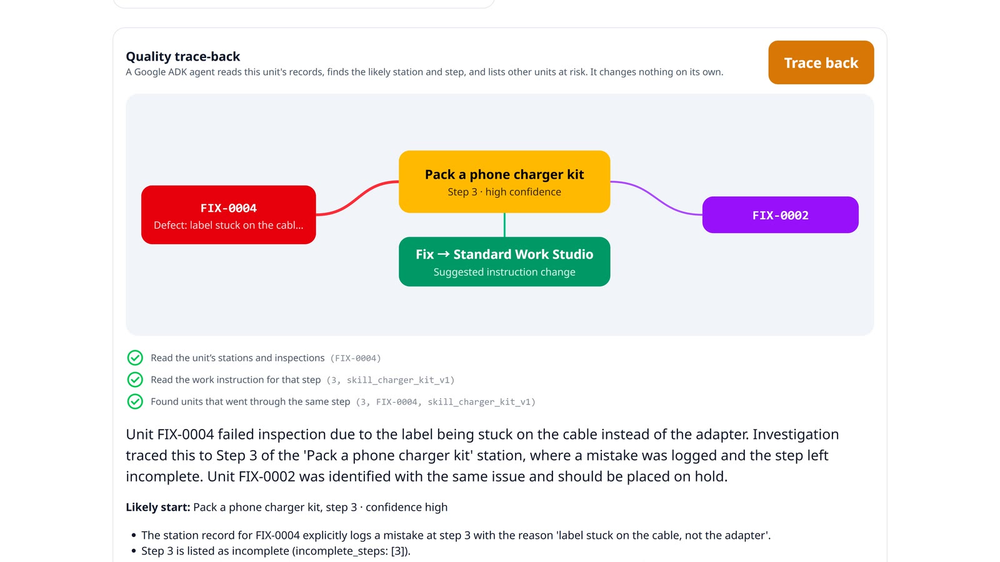
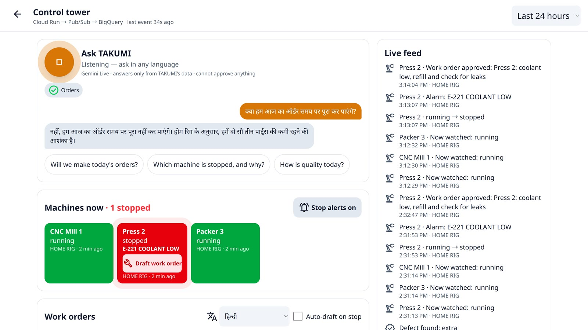
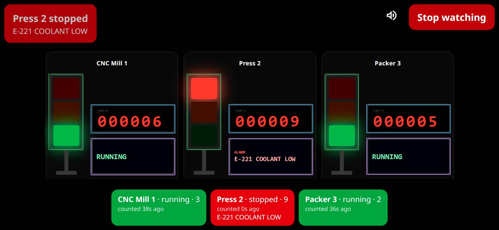
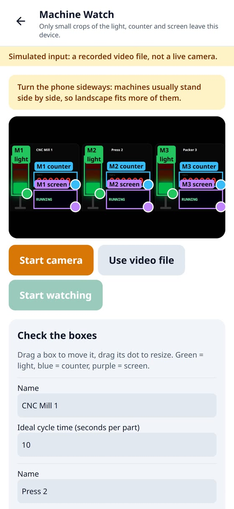
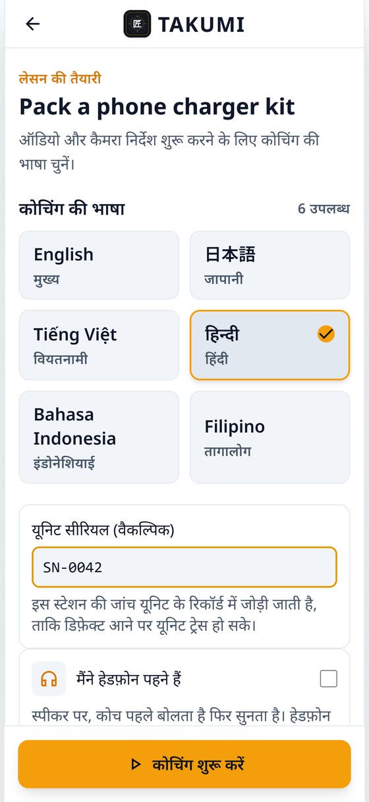

<p align="center">
  
</p>

<h1 align="center">TAKUMI (匠)</h1>

<p align="center"><b>AI quality and operations for factories that aren't connected.</b><br>
Any camera a factory already has becomes its quality and operations layer, built on Google Cloud and Gemini.</p>

<p align="center"><i>Google Cloud AI Builder Cup 2026 · Manufacturing: Intelligent Operations &amp; Industrial Efficiency</i></p>

| | Link |
| :--- | :--- |
| 🌐 **Live app** | [takumi-cup-2026.web.app](https://takumi-cup-2026.web.app) |
| 🧭 **Judges' guide** (accounts and 5-minute walkthroughs) | [docs/JUDGES.md](docs/JUDGES.md) |
| 🎬 **Product tour** (no sign-in needed) | [takumi-cup-2026.web.app/tour](https://takumi-cup-2026.web.app/tour) |
| 📊 **Evaluations** (method, results, cost; public) | [takumi-cup-2026.web.app/evals](https://takumi-cup-2026.web.app/evals) |
| 🟢 **System status** (API and a live Gemini check) | [takumi-cup-2026.web.app/status](https://takumi-cup-2026.web.app/status) |
| 🧩 **Architecture** | [docs/architecture.md](docs/architecture.md) |
| ✅ **What is live** | [docs/FEATURE_STATUS.md](docs/FEATURE_STATUS.md) |
| 🔐 **Security and privacy** | [docs/SECURITY.md](docs/SECURITY.md) |
| 💻 **Run it locally** | [Running locally](#running-locally) |

---

## The problem

Small and mid-sized factories run machines without data connections, manual assembly stations and visual checks done by tired eyes. Retrofitting sensors, an MES and machine-vision stations is expensive, so most of these plants run blind: stoppages go unrecorded, defects are found late, and when a bad unit reaches a customer nobody can say where it went wrong.

## What TAKUMI does

TAKUMI turns **a camera the factory already has** (an old phone or a cheap webcam, mounted and plugged in) into a quality and operations layer. Gemini watches the machines, the manual work and the finished parts; Google ADK agents turn what it sees into work orders, holds and instruction fixes that **a person approves**.

| | What happens | Google AI / Cloud doing the work |
|---|---|---|
| **Machine Watch** | A phone reads stack lights, parts counters and HMI alarm screens with no wiring. One setup call finds the regions; the browser checks them twice a second for free; Gemini reads only when something changes. | `gemini-robotics-er-2-preview` (setup), `gemini-3.5-flash-lite` (reads) |
| **Maintenance agent** | When a machine stops, an agent reads its state, 7 days of stops and alarms, the alarm guide and past work orders, and drafts a work order with likely causes, steps, safety and parts. The floor alert is spoken in six languages. | Google ADK on `gemini-3.8-flash` + `gemini-3.5-flash-lite`, `gemini-3.8-flash-tts` |
| **End-of-line inspection** | A photo of each finished unit is screened against 3 known-good references; a second model confirms suspected defects; a person confirms or overrides every flag. Judges can try it on real public-dataset parts. | `gemini-3.5-flash-lite` (screen), `gemini-3.8-flash` (confirm) |
| **Station Watch** | At a manual station the camera follows each step of the work instruction, speaks to the operator in their language, points at the right spot, passes a step only on visible facts and raises a full-screen STOP on a hazard. | `gemini-3.8-live`, `gemini-3.5-flash-lite` (step watcher), `gemini-3.8-flash` (verifier), `gemini-robotics-er-2-preview` (pointing) |
| **Unit records & trace-back** | A serial links each unit's stations and inspections. When a unit fails, an agent finds the station and step where the defect started, the other units that went through the same step, and a fix to the instruction. | Google ADK on `gemini-3.8-flash`, Firestore |
| **Standard Work Studio** | A master records a task once. Gemini watches the video and writes the steps with visible success criteria and reasons; Robotics-ER points at each part; a checker flags subjective criteria; the instruction is translated into five languages for the master to review. | Google ADK 2 Workflow, `gemini-3.8-flash` (video, translation), `gemini-robotics-er-2-preview`, `gemini-3.5-flash-lite` |
| **Control tower & Ask TAKUMI** | Every event flows through Pub/Sub into BigQuery; the control tower shows quality, stoppages, holds and today's orders. Supervisors ask by voice in any language ("Will we make today's orders?"); Gemini Live answers from TAKUMI's own data and can call the planner and maintenance agents, but cannot approve anything. | Pub/Sub, BigQuery, `gemini-3.8-live` with function calling, Google ADK planner agent |

**AI informs, people decide.** Every hold, defect decision, work order and instruction change is approved by a person.

---

## Screenshots

All screenshots are of the deployed app.

| | |
| :---: | :---: |
| <br>**Home:** every role's tools on one screen, in six languages | <br>**Tour:** the story and the evidence, no sign-in needed |
| <br>**A machine stops:** the maintenance agent drafts the work order in 17 s, with the evidence it used | <br>**A unit fails:** the trace-back agent finds the step and the other unit to hold |
| <br>**Ask TAKUMI:** a spoken question in Hindi, answered by voice from real counts | <br>**Machine Watch:** the phone sees Press 2 stop with an alarm in seconds |
| <br>**Setup:** Gemini Robotics-ER boxes every lamp, counter and screen | <br>**Station Watch** in the operator's language (six languages) |

A 2:49 demo video shows the whole shift end to end.

---

## Honest numbers

Every number TAKUMI shows is labelled **LIVE** (our deployment), **HOME RIG** (our test bench filmed by a real phone), **PUBLIC DATA** (dataset and licence) or **TEST FIXTURES** (scripted records with a known answer). Generated or simulated data is never shown as real.

| What | Result | Label |
| :--- | :--- | :--- |
| Visual inspection on 2,162 real test images, 12 product categories | **88.4%** accuracy, 80.2% of defects caught, 1.4% false alarms, **$0.0022** per part | PUBLIC DATA (Amazon VisA, CC BY 4.0) |
| Machine Watch soak run on the test bench | **61 of 61** stops caught, median **3.6 s** to see a stop | HOME RIG |
| Machine Watch model cost | about **$4.60** per machine per month for one shift (measured tokens × list price) | estimate |
| Maintenance agent on scripted stops (6 alarm codes, first and repeat) | **12/12** checks passed, median 17 s | TEST FIXTURES |
| Trace-back agent on scripted failures | **4/4** right step and exact units to hold, median 21 s | TEST FIXTURES |

Method, caveats and per-category results: [/evals](https://takumi-cup-2026.web.app/evals), [evals/inspection](evals/inspection), [evals/machine_watch](evals/machine_watch), [evals/agents](evals/agents).

---

## Architecture


- **Two Cloud Run services** in `asia-southeast1`: `takumi-api` (FastAPI: inspection, Station Watch, Machine Watch, units, orders, work orders, the control tower) and `takumi-forge` (Google ADK agents and the Standard Work Studio workflow).
- **Firebase Hosting and Auth** serve the React app and sign-in; roles (trainee, supervisor, master) live in a custom claim and are enforced by the API and by Firestore and Storage rules.
- **Firestore** is the source of truth; **Cloud Storage** holds evidence frames and photos behind short-lived signed URLs; **Pub/Sub → BigQuery** carries every event to the control tower and the evaluations.
- **The browser never sees an API key.** Gemini Live uses single-use tokens; user text is screened by **Model Armor**; keys live in **Secret Manager**; **Cloud Monitoring** alerts on API, Gemini and Forge health; **Cloud Build** tests and deploys every push.

Details and the main flows: [docs/architecture.md](docs/architecture.md).

| Google service / model | Job in TAKUMI |
|---|---|
| `gemini-3.5-flash-lite` | Inspection screening; Station Watch step watcher; Machine Watch reads; maintenance reporter; Studio criteria check |
| `gemini-3.8-flash` | Inspection confirmation; step verification; ADK agents; Studio video-to-steps and translation |
| `gemini-3.8-live` | Station Watch voice coaching and the Ask TAKUMI copilot, in six languages |
| `gemini-3.8-flash-tts` | Spoken floor alerts for work orders |
| `gemini-robotics-er-2-preview` | Pointing at parts; finding lights, counters and screens at Machine Watch setup; Studio pointing hints |
| Google ADK 2 | Studio workflow graph; maintenance, trace-back and planner agents (tools + response schemas) |
| Cloud Run, Firebase Hosting + Auth, Firestore, Cloud Storage | Serving, sign-in and roles, records and media |
| Pub/Sub, BigQuery | Event pipeline, control tower, live evaluations |
| Model Armor, Secret Manager, Cloud Monitoring & Logging, Cloud Build | Safety screening, keys, alerts and the status page, CI/CD |

Model IDs live only in `services/*/config.py` and can be overridden by environment variables. Temperature is never set.

---

## Privacy and safety by design

- **Process monitoring, not people monitoring:** no faces stored, no individual worker scoring; operators appear only as a short anonymous id, and the trace-back agent never sees who the operator was.
- Machine Watch sends only small region crops; Station Watch keeps evidence frames only for mistakes and safety stops; the Studio's video copy for Gemini is deleted after use.
- Holds, defect decisions, work orders and instruction changes always need a person's approval.
- Per-user and per-service daily limits on AI calls; public endpoints are rate limited per IP.

---

## Running locally

### Prerequisites

| Tool | Version | Needed for |
| :--- | :--- | :--- |
| [Node.js](https://nodejs.org) | 20 or newer (tested on 24) | the web app and its tests |
| [Python](https://www.python.org) | 3.12 | the API, the Forge service and their tests |
| [Git](https://git-scm.com) | any recent | cloning |
| Java 21 + Firebase CLI | optional | the Firestore and Storage rules tests (emulator) |
| Google Cloud SDK | optional | running the backend on your own project |

### Option A: the web app on your machine, against the live backend (5 minutes)

**Windows (PowerShell)**

```powershell
git clone https://github.com/DivineTechie/takumi.git
cd takumi
npm --prefix apps/web install
Copy-Item apps/web/.env.example apps/web/.env.development.local
notepad apps/web/.env.development.local   # set VITE_DEV_API_TARGET and the six Firebase values (see the comments)
npm --prefix apps/web run dev
```

**macOS / Linux**

```bash
git clone https://github.com/DivineTechie/takumi.git
cd takumi
npm --prefix apps/web install
cp apps/web/.env.example apps/web/.env.development.local
nano apps/web/.env.development.local      # set VITE_DEV_API_TARGET and the six Firebase values (see the comments)
npm --prefix apps/web run dev
```

Open http://localhost:5173 and sign in with a judge account ([docs/JUDGES.md](docs/JUDGES.md)). Vite proxies `/api` and `/forge` to the deployed services. The Firebase values are the public web configuration served at `https://takumi-cup-2026.web.app/__/firebase/init.json`.

### Option B: run the tests

**Windows (PowerShell)**

```powershell
py -3.12 -m venv .venv
.venv\Scripts\Activate.ps1
pip install -r requirements-dev.txt -r services/api/requirements.txt -r services/forge/requirements.txt
python -m pytest                      # API, shared models, evaluation scripts
python -m pytest services/forge       # Studio workflow and ADK agents (Gemini mocked)
npm --prefix apps/web test            # web app (Vitest)
npm --prefix apps/web run lint
npm --prefix apps/web run build
```

**macOS / Linux**

```bash
python3.12 -m venv .venv
source .venv/bin/activate
pip install -r requirements-dev.txt -r services/api/requirements.txt -r services/forge/requirements.txt
python -m pytest
python -m pytest services/forge
npm --prefix apps/web test
npm --prefix apps/web run lint
npm --prefix apps/web run build
```

Security rules tests (needs Java 21), from the repository root: `npm --prefix infra/rules-tests install`, then `npx firebase-tools emulators:exec --only firestore,storage --project takumi-rules-test "npm test --prefix infra/rules-tests"`.

### Option C: the whole stack on your own Google Cloud project

1. Create a Firebase project with Firestore (Native), one Cloud Storage bucket, Google and email/password sign-in, and a BigQuery dataset `takumi`; create the events pipeline with [`infra/events_pipeline.sh`](infra/events_pipeline.sh).
2. Store your Gemini API key in Secret Manager as `GEMINI_API_KEY` (or export it in your shell for local runs only), then sign in with `gcloud auth application-default login`.
3. Start the services from the repository root (inside the virtual environment from Option B):

   ```bash
   # macOS / Linux (on Windows PowerShell set each one with $env:NAME="value")
   export GOOGLE_CLOUD_PROJECT=your-project-id GEMINI_API_KEY=your-gemini-api-key LOCAL_DEV=1
   export FIREBASE_STORAGE_BUCKET=your-bucket STORAGE_BUCKET=your-bucket
   uvicorn services.api.main:app --port 8080 --reload
   uvicorn services.forge.main:app --port 8081 --reload    # in a second terminal
   ```

4. In `apps/web/.env.development.local` set `VITE_DEV_API_TARGET=http://localhost:8080`, `VITE_DEV_FORGE_TARGET=http://localhost:8081` and your project's Firebase web config, then `npm --prefix apps/web run dev`. Give your account a role with [`infra/set_role.py`](infra/set_role.py) and load the sample work instructions with [`infra/load_seed.py`](infra/load_seed.py).

`LOCAL_DEV=1` enables CORS for localhost and lets the local Forge service accept requests without a Firebase token: use it on your own machine only. Deploying your own copy: [docs/SETUP.md](docs/SETUP.md) and [`infra/cloudbuild.yaml`](infra/cloudbuild.yaml).

---

## Project structure

```
takumi/
├── apps/web/                 React 19 + Vite + TypeScript app (Firebase Hosting)
│   └── src/
│       ├── pages/            screens: home, inspection, gallery, Machine Watch, test bench, Station Watch,
│       │                     unit records, dashboard, control tower, tour, evaluations, status
│       ├── components/       control tower panels (machines, work orders, orders, Ask TAKUMI), dashboard, shared UI
│       ├── features/         Standard Work Studio: record a task, follow the run, review and publish, library
│       ├── lib/              API client, Gemini Live clients, Machine Watch edge vision, helpers
│       ├── i18n/             six languages (English, 日本語, Tiếng Việt, हिन्दी, Bahasa Indonesia, Filipino)
│       └── evals/            published evaluation results shown on /evals and /tour
├── services/
│   ├── api/                  Cloud Run takumi-api (FastAPI): inspection, Station Watch, Machine Watch, units,
│   │                         orders, work orders and spoken alerts, control tower, status, events bus
│   └── forge/                Cloud Run takumi-forge: Google ADK agents (maintenance, trace-back, demand)
│                             and the Standard Work Studio workflow (graph/)
├── shared/
│   ├── schema/               JSON Schema contracts with generated TypeScript and Pydantic models
│   ├── ops/                  shared logic: alarm guide, order projection
│   └── seed/                 sample work instructions
├── evals/                    inspection benchmark (VisA), Machine Watch soak scoring, agent scenarios
├── infra/                    Cloud Build, events pipeline, data loaders, roles, translation, rules tests
├── docs/                     judges' guide, architecture, feature status, security, setup, screenshots
├── firestore.rules           Firestore security rules (tested in CI)
├── storage.rules             Cloud Storage security rules (tested in CI)
└── firebase.json             Hosting, rewrites to Cloud Run, headers
```

Regenerate the shared models after a schema change with `npm run schema` from the repository root.

---

## Delivery

Every push to `main` runs the API, Forge, web and security-rules tests in parallel, builds both containers and deploys both Cloud Run services, the rules and Hosting through Cloud Build ([`infra/cloudbuild.yaml`](infra/cloudbuild.yaml)).

---

## Context: who works on these floors

Manufacturing in Asia increasingly relies on workers who are new to the job and to the language. In Japan, foreign workers reached **2,571,037** at the end of October 2025, Vietnamese nationals the largest group at **605,906** ([MHLW](https://www.mhlw.go.jp/content/11655000/001646128.pdf)); **6,244** foreign workers were killed or injured at work in 2024, with poor communication among the causes cited ([Business & Human Rights Resource Centre](https://www.business-humanrights.org/en/latest-news/japan-number-of-work-related-injuries-and-deaths-among-foreign-workers-exceeds-6000-for-the-first-time-in-2024/)). In South Korea, workers under the Employment Permit System reached a record **287,424** in July 2026, **229,844** of them in manufacturing ([The Korea Times](https://www.koreatimes.co.kr/southkorea/20260902/number-of-foreign-workers-under-employment-permit-system-hits-record-high)). TAKUMI speaks to each of them in their own language.

---

## Licence and credits

Licensed under the Apache License 2.0 ([LICENSE](LICENSE)). Public dataset images: [VisA](https://github.com/amazon-science/spot-diff) (Amazon), CC BY 4.0.

<sub>**AI tools disclosure.** TAKUMI's features run on Google Gemini models and Google ADK, as listed above. During development the team used AI coding assistants (Claude Code and Google Antigravity) for code suggestions, reviews and tests, and Google Stitch for early UI mock-ups; every change was reviewed, tested and committed by the team. The interface translations for five languages are machine-made with Gemini and marked for native review. In the demo video, the narration is Gemini TTS and two short b-roll shots are generated with Veo and labelled "AI-generated" on screen; every product scene is a screen recording of the live app.</sub>
