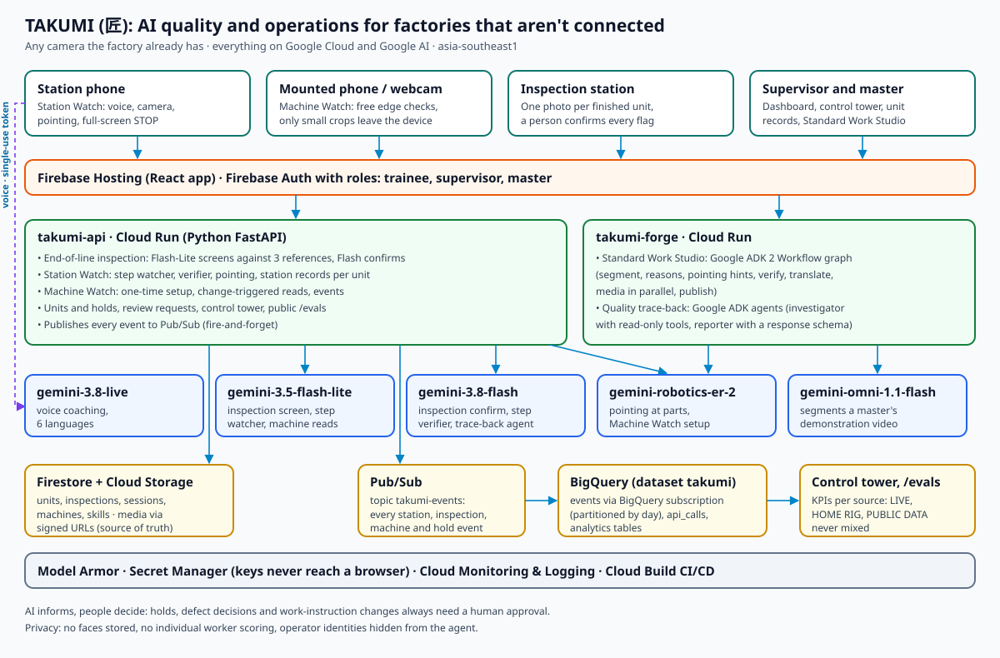

# TAKUMI (匠): AI quality and operations for factories that aren't connected

> **Google Cloud AI Builder Cup 2026, Manufacturing: Intelligent Operations & Industrial Efficiency**
> **Live app**: [https://takumi-cup-2026.web.app](https://takumi-cup-2026.web.app) · **Status**: [/status](https://takumi-cup-2026.web.app/status) · **Judges' guide**: [docs/JUDGES.md](docs/JUDGES.md) · **Feature status**: [docs/FEATURE_STATUS.md](docs/FEATURE_STATUS.md)

Small and mid-sized factories run on machines without data connections, manual assembly stations, and visual checks done by tired eyes. Retrofitting sensors, MES and machine-vision stations is expensive, so most of these plants run blind: stoppages go unrecorded, defects are found late, and nobody can say where a bad unit went wrong.

TAKUMI turns **a camera the factory already has** (an old phone or a cheap webcam, mounted and plugged in) into a quality and operations layer. Google Gemini watches the work, the machines and the finished parts; agents turn what it sees into decisions that a person approves.

**AI informs, people decide.** Every hold, defect and work-instruction change is approved by a human.

---

## What it does

| | What happens | Google AI / Cloud doing the work |
|---|---|---|
| **End-of-line inspection** | A photo of each finished unit is screened against 3 known-good references, and a second model confirms suspected defects. A person confirms or overrides every flag. Judges can try it on real public-dataset parts with the ground truth revealed only after inspecting. | `gemini-3.5-flash-lite` (screen) + `gemini-3.8-flash` (confirm), Cloud Run, Firestore, Cloud Storage |
| **Station Watch** | At a manual station the camera follows each step of the work instruction, speaks to the operator in their language, points at the right spot, blocks the unit until a step is visibly correct, and raises a full-screen STOP on a safety hazard. | `gemini-3.8-live` (voice), `gemini-3.5-flash-lite` (step watcher), `gemini-3.8-flash` (verifier), `gemini-robotics-er-2-preview` (pointing) |
| **Machine Watch** | The camera reads stack lights, parts counters and HMI alarm screens, with no wiring: uptime, stops, alarms and counts. "Gemini configures, the edge watches, Gemini reasons": one setup call finds the regions, the browser checks them for free twice a second, and Gemini reads them only when something changes. | `gemini-robotics-er-2-preview` (setup), `gemini-3.5-flash-lite` (reads) |
| **Unit records & quality trace-back** | Each unit's serial links its stations and inspections. When a unit fails, an ADK agent finds the station and step where the defect most likely started, the other units that went through the same step, and a fix to the work instruction. The supervisor approves holds; the master applies the fix in the Standard Work Studio. | Google ADK agents on `gemini-3.8-flash`, Firestore |
| **Standard Work Studio** | A master demonstrates a task once; a Google ADK 2 workflow turns the video into a step-by-step instruction with success criteria, the reason for each step, pointing hints and translations into 6 languages. | ADK 2 Workflow graph, `gemini-omni-1.1-flash`, `gemini-3.8-flash`, `gemini-robotics-er-2-preview` |
| **Events pipeline & control tower** | Every station step, inspection, machine event and hold is published to Pub/Sub; a BigQuery subscription stores it; the control tower shows quality, stoppages and holds per source. | Pub/Sub, BigQuery |
| **Demand agent** | "Will we make today's orders?" Orders are projected from real machine counts and inspection yield (plain code); an ADK planner agent explains the risk and the constraint and suggests actions for the supervisor. | Google ADK agent on `gemini-3.8-flash` |

---

## Honest numbers

Every number TAKUMI shows is labelled **LIVE** (our deployment), **HOME RIG** (our test bench filmed by a real camera) or **PUBLIC DATA** (dataset + licence). Simulated or generated data is never shown as real.

- **Visual inspection, PUBLIC DATA** (Amazon VisA, CC BY 4.0): measured on the VisA test split across 12 product categories with the exact shipped prompt, models and reference images. Results, method and cost per image are on the [/evals](https://takumi-cup-2026.web.app/evals) page and in [evals/inspection](evals/inspection).
- **Machine Watch, HOME RIG**: soak runs on the test bench are scored for detection rate, detection delay, false alarms and cost per machine by [evals/machine_watch/score_soak.py](evals/machine_watch/score_soak.py).
- **Station Watch, LIVE**: latencies are measured in production and stored in BigQuery `takumi.api_calls`.

---

## Architecture



```
 phone / webcam ──► Firebase Hosting (React) ──► Cloud Run takumi-api (FastAPI) ──► Gemini (inspection, watcher, verifier, pointing, machine reads)
        │                                              │      └─► Firestore · Cloud Storage · Model Armor · Secret Manager
        └── Gemini Live (single-use tokens) ◄──────────┘      └─► Pub/Sub takumi-events ──► BigQuery subscription ──► takumi.events ──► control tower
                                                       Cloud Run takumi-forge: Standard Work Studio (ADK 2 Workflow) · trace-back agent (ADK)
```

- **Two Cloud Run services** in `asia-southeast1`: `takumi-api` (the product API) and `takumi-forge` (Google ADK workflows and agents).
- **Firestore** is the source of truth for the app; **BigQuery** holds analytics (`takumi.events`, `takumi.api_calls`, `takumi.session_events`, `takumi.inspection_events`, `takumi.machine_events`).
- **Only small crops leave a device** for Machine Watch; setup frames are never stored; the trace-back agent never sees who the operator was.
- Details: [docs/architecture.md](docs/architecture.md).

### Google services and models

| Service / model | Job in TAKUMI |
|---|---|
| `gemini-3.5-flash-lite` | Inspection screening against references; Station Watch step watcher; Machine Watch reads |
| `gemini-3.8-flash` | Inspection confirmation; step verification against visible success criteria; trace-back agent |
| `gemini-3.8-live` | Real-time voice coaching in 6 languages |
| `gemini-robotics-er-2-preview` | Pointing at parts; finding stack lights, counters and HMI screens at Machine Watch setup |
| `gemini-omni-1.1-flash` | Segmenting a master's demonstration video into steps |
| Google ADK 2 | Standard Work Studio workflow graph; quality trace-back agent (investigator with tools + reporter with a response schema) |
| Cloud Run, Firebase Hosting, Firebase Auth | Serving, sign-in, roles (trainee, supervisor, master) |
| Firestore, Cloud Storage | Records and media (signed URLs only) |
| Pub/Sub, BigQuery | Event pipeline and analytics |
| Model Armor, Secret Manager | Screening user text; keys never reach a browser |
| Cloud Build, Cloud Monitoring & Logging | CI/CD with tests on every push; alerts and the status page |

Model IDs live only in `services/*/config.py` and `apps/web/src/config.ts`. Temperature is never set.

---

## Privacy and safety by design

- Process monitoring, not people monitoring: no faces stored, no individual worker scoring, operator identities hidden from the agent and from other workers.
- Machine Watch sends only region crops; Station Watch stores evidence frames only for mistakes and safety stops.
- Holds, defect decisions and instruction changes always need a human approval.
- Keys stay in Secret Manager; the browser uses single-use Live tokens; user text is screened by Model Armor; Firestore and Storage rules enforce roles.

---

## Status and limitations

[docs/FEATURE_STATUS.md](docs/FEATURE_STATUS.md) lists what is live and what is in progress. In short: inspection, Station Watch, the dashboard, unit records, the events pipeline and the control tower are deployed; Machine Watch and the trace-back agent are deployed and are being proven on home-rig and real station data; the demand agent is deployed and being proven on home-rig data; windowed aggregation in Dataflow is planned.

---

## Running locally

Prerequisites: Node.js 24+, Python 3.12+, Google Cloud SDK, Firebase CLI.

```bash
git clone https://github.com/DivineTechie/takumi.git
cd takumi
python -m venv .venv
.venv/Scripts/activate            # Windows (source .venv/bin/activate on Linux/macOS)
pip install -r requirements-dev.txt -r services/api/requirements.txt
npm run schema                    # regenerate TS + Pydantic models from /shared/schema
npm --prefix apps/web install
npm --prefix apps/web run dev     # proxies /api to the Cloud Run API, see docs/DEVELOPMENT.md
```

Tests: `pytest` (API), `pytest services/forge` (Studio and agents, own requirements), `npm --prefix apps/web test`, and the Firestore/Storage rules tests in `infra/rules-tests`.

Deployment: every push to the `coach` branch runs the tests and deploys both Cloud Run services, the security rules and Hosting through Cloud Build (`infra/cloudbuild-coach.yaml`).

---

## Context: why the station matters

Manufacturing hubs in Asia increasingly rely on workers who are new to the job and to the language. In Japan, foreign workers reached **2,571,037** at the end of October 2025, Vietnamese nationals the largest group at **605,906** ([MHLW](https://www.mhlw.go.jp/content/11655000/001646128.pdf)); **6,244** foreign workers were killed or injured in 2024, with poor communication among the causes cited ([Business & Human Rights Resource Centre](https://www.business-humanrights.org/en/latest-news/japan-number-of-work-related-injuries-and-deaths-among-foreign-workers-exceeds-6000-for-the-first-time-in-2024/)). In South Korea, workers under the Employment Permit System reached a record **287,424** in July 2026, **229,844** of them in manufacturing ([The Korea Times](https://www.koreatimes.co.kr/southkorea/20260902/number-of-foreign-workers-under-employment-permit-system-hits-record-high)). Station Watch's guidance in the operator's own language, and its safety STOP, are built for that floor.

---

## Team and licence

Team TAKUMI, two members. Licensed under the Apache License 2.0 ([LICENSE](LICENSE)). Public dataset images: VisA (Amazon), CC BY 4.0.
