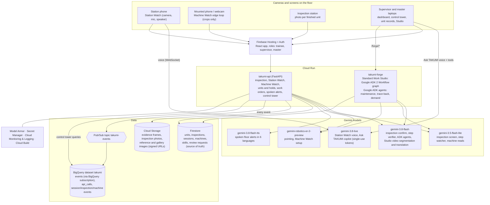

# TAKUMI (匠): architecture

TAKUMI turns a camera a factory already has into a quality and operations layer. Everything runs on Google Cloud and Google AI in `asia-southeast1`.

## Diagram

## Main flows

- **End-of-line inspection.** `POST /api/inspect` stores the photo, runs Flash-Lite with 3 known-good references, and runs Flash only when the screen flags a defect (default "few false alarms" mode; "catch everything" runs both in parallel). Timeouts give "needs review", never "ok". A supervisor confirms or overrides each flag. The judges' gallery runs the same pipeline on VisA test images loaded by the server, and reveals the dataset label only after inspecting.
- **Station Watch.** The browser talks to `gemini-3.8-live` with a single-use token. Camera frames go to the step watcher (Flash-Lite) through the API; what the camera sees is injected into the conversation as text events, and only the verifier (Flash) can pass a step. Mistakes and safety stops keep an evidence frame. A session started with a unit serial adds a station record to that unit.
- **Machine Watch.** One Robotics-ER call per machine finds the stack light, counter and HMI regions. The browser checks those regions every 500 ms (lamp colour and pixel change) and sends small crops to `POST /api/machines/{id}/read` only on a stable change (plus a 5-minute heartbeat, at most 6 reads per machine per minute). The API writes an event only when the state, alarm or count really changed.
- **Trace-back.** `POST /forge/agents/traceback` (supervisor) runs an ADK investigator agent with read-only tools (unit history, similar units at the same station and step, the step's work instruction) and a reporter agent with a response schema. Hold candidates are checked against what the tools returned. Holds (`POST /api/units/hold`) and review requests (`POST /api/review-requests`) happen only when a supervisor approves; the master applies a request in the Studio.
- **Maintenance agent.** `POST /forge/agents/maintenance` (supervisor, machine must be stopped) runs an ADK investigator with four read-only tools (machine status, 7-day stops and alarms, the alarm guide, past work orders), called in parallel with low thinking, and a Flash-Lite reporter with a response schema. The draft is saved in `work_orders`; a repeat request for the same stop within an hour returns the same draft. `POST /api/work-orders/{id}/decision` approves or dismisses it (published as an event); `POST /api/work-orders/{id}/speak` translates the floor alert (Flash-Lite) and speaks it (Gemini TTS), caching the audio in Cloud Storage per language.
- **Ask TAKUMI.** The control tower opens a Gemini Live session with a single-use, supervisor-only token. The model's function calls (machines now, orders projection, quality totals, work orders, the planner agent, the maintenance agent) run in the browser against TAKUMI's API with the supervisor's own sign-in, so the model can only see data the supervisor can see and cannot approve anything.
- **Standard Work Studio.** An ADK 2 `Workflow` graph of FunctionNodes: load the capture, then `gemini-3.8-flash` watches the uploaded video (Gemini Files API, deleted after use) and writes the steps with their reasons and timestamps; then in parallel Robotics-ER points at each step's part on an in-memory key frame, Flash-Lite checks that each success criterion is a visible fact, and Flash translates into five languages; join, then the lesson is validated against the schema and saved for the master's review. Each node reports its own progress and errors; runs are limited per master per day. Details: [services/forge/README.md](../services/forge/README.md).
- **Events.** `services/api/events_bus.py` publishes one event shape to Pub/Sub (fire-and-forget, never slowing a request). A BigQuery subscription writes it to `takumi.events` (partitioned by day, clustered by kind and source). `GET /api/control/summary` aggregates it per source label for the control tower.

## Security and privacy

- Keys live in Secret Manager; browsers receive only single-use Live tokens. User text is screened by Model Armor.
- Firestore and Storage rules enforce roles; media is served through short-lived signed URLs.
- Machine Watch sends only region crops and never stores the setup frame. The trace-back agent never receives operator identities; operator ids are shown only to supervisors.
- Every hold, defect decision and instruction change needs a human approval.
- Every number is labelled LIVE, HOME RIG or PUBLIC DATA.

## Delivery

Every push to `coach` runs Python, Forge, web and security-rules tests in parallel, builds both containers, deploys both Cloud Run services, the rules and Hosting (`infra/cloudbuild-coach.yaml`). The events pipeline is created by `infra/events_pipeline.sh`.
