# TAKUMI (匠) — Technical Architecture

TAKUMI captures a master craftsman's hands-on technique once and teaches it live to any worker across JAPAC languages through a phone camera and bidirectional voice.

---

## High-Level Architecture Diagram

```mermaid
flowchart TD
  subgraph Clients["Clients & Edge Devices"]
    Trainee["Trainee Phone (PWA)<br/>• Camera (1 FPS JPEG)<br/>• 16 kHz Mic / 24 kHz Speaker"]
    Supervisor["Supervisor Laptop<br/>• Live Dashboard (1440x900)<br/>• Active sessions, matrix, replay"]
    Master["Master Craftsman (UI)<br/>• Capture & Review UI (Member B)"]
    Hosting["Firebase App Shell<br/>• Firebase Hosting (CDN)<br/>• Firebase Auth (Google / Email)"]
  end

  subgraph CloudRun["Cloud Run & Security (asia-southeast1)"]
    API["takumi-api (Cloud Run)<br/>• Python 3.12 FastAPI (Member A)<br/>• /api/live-token (single-use)<br/>• /api/watch (1-FPS watcher proxy)<br/>• /api/verify, /api/point<br/>• /api/sessions & /api/status"]
    Forge["takumi-forge (Cloud Run)<br/>• Google ADK 2.0 Graph (Member B)<br/>• Video segmentation & extraction<br/>• Multilingual localization"]
    Armor["Model Armor<br/>Prompt injection & safety screening"]
    Secrets["Secret Manager<br/>GEMINI_API_KEY (server-only)"]
    Monitoring["Cloud Monitoring & Logs<br/>Structured logs, latency alerts"]
  end

  subgraph GeminiModels["Google AI Models (google-genai SDK)"]
    Live["gemini-3.8-live<br/>Direct Bidirectional Audio WebSocket<br/>Single-use ephemeral token"]
    Watcher["gemini-3.5-flash-lite<br/>1-FPS Step Watcher & Healthcheck"]
    Verifier["gemini-3.8-flash<br/>Objective Step Verifier"]
    Pointer["gemini-robotics-er-2-preview<br/>Spatial Pointing & Coordinates"]
    ForgeModels["Forge Models (Member B - in progress)<br/>• gemini-omni-1.1-flash (segmentation)<br/>• gemini-3.8-flash (why & translate)<br/>• veo-3.1-fast-generate-preview (mistakes)<br/>• gemini-3.1-flash-image (diagram cards)"]
  end

  subgraph DataLayer["Google Cloud Data Layer (asia-southeast1)"]
    Firestore[("Cloud Firestore (Native)<br/>• skills, sessions, events<br/>• review_requests, passports")]
    Storage[("Cloud Storage<br/>• Step frame JPEGs<br/>• Badge SVG/PNGs<br/>• Master video captures")]
    BigQuery[("BigQuery (dataset: takumi)<br/>• session_events (audit trail)<br/>• api_calls (latency metrics)")]
  end

  %% Client flows
  Trainee -- "wss:// (Direct Live WebSocket)" --> Live
  Trainee -- "POST /api/watch, /api/verify, /api/point" --> API
  Supervisor -- "REST API & Firestore stream" --> API
  Master -. "Upload raw capture" .-> Forge
  Hosting -- "Custom claims role auth" --> Trainee
  Hosting -- "Custom claims role auth" --> Supervisor

  %% API flows
  API --> Armor
  API --> Secrets
  API --> Watcher
  API --> Verifier
  API --> Pointer
  API --> Firestore
  API --> Storage
  API --> BigQuery
  API --> Monitoring

  %% Forge flows
  Forge -.-> ForgeModels
  Forge -.-> Firestore
  Forge -.-> Storage

  classDef live fill:#eff6ff,stroke:#2563eb,stroke-width:2px;
  classDef inprogress fill:#f8fafc,stroke:#94a3b8,stroke-width:2px,stroke-dasharray: 5 5;
  classDef databox fill:#fefce8,stroke:#ca8a04,stroke-width:2px;
  classDef compute fill:#f0fdf4,stroke:#15803d,stroke-width:2px;

  class Live,Watcher,Verifier,Pointer live;
  class Forge,ForgeModels,Master inprogress;
  class Firestore,Storage,BigQuery databox;
  class API,Hosting,Armor,Secrets,Monitoring compute;
```

---

## Architectural Principles & Rationale

### 1. Dual-Model Decoupled Watcher & Voice Design
The Gemini Live model (`gemini-3.8-live`) is an expressive, ultra-low-latency bidirectional conversational agent. However, conversational models should never evaluate whether a manufacturing task succeeded:
- Conversational models can hallucinate step completion or be talked into false passes by trainees.
- Pure voice models react to audio cues, whereas physical assembly is verified through visible physical facts.

**Solution**:
1. An independent visual step watcher (`gemini-3.5-flash-lite`) samples camera frames at 1 FPS via `POST /api/watch`. It evaluates progress, common mistakes, and safety hazards, returning structured state in <2.5 s.
2. When the watcher detects an event, it posts a session event to Firestore and injects a factual text event into the Live socket context:
   `[CAMERA EVENT] Step 1 in progress: blue wire inserted into terminal 1.`
3. When the trainee indicates completion ("done") or the watcher detects completion, an objective step verifier (`gemini-3.8-flash`) runs against strict success criteria and safety rules.
4. If a step passes, `takumi-api` advances the step. The Live coach reacts naturally to the injected event, speaking immediate feedback in the trainee's language.

### 2. Zero Browser Key Exposure & Ephemeral Tokens
- The browser never receives an API key or persistent credential.
- To connect to the Gemini Live WebSocket, the browser calls `POST /api/live-token`, authenticated with a Firebase Auth ID token carrying the `trainee` or `supervisor` role claim.
- The server issues a single-use ephemeral token constrained to `gemini-3.8-live` with audio-only modalities, expiring in 12 minutes (with a 1-minute handshake window). Reconnecting with the same token is strictly rejected.

### 3. Safety First & Latency Resilience
- **Model Armor**: User-supplied text and target point prompts are screened by Model Armor in `asia-southeast1` before reaching Gemini.
- **Fail-Open / Fast Recovery**: If network drops occur, the web client limits reconnects to 3 within a rolling 60-second window, resuming at the current step.
- **Graceful Quota Degradation**: When upstream quota or credit exhaustion is detected, the API returns a structured HTTP 503 (`Coaching is temporarily unavailable.`), and the UI displays a non-blocking notification banner rather than looping or failing silently.
- **Telemetry & Status Monitoring**: API call durations (`model_ms` and `total_ms`) are recorded fire-and-forget to BigQuery table `takumi.api_calls`. The public `/status` endpoint surfaces transparent p50 and p90 latencies computed across the last 24 hours.
